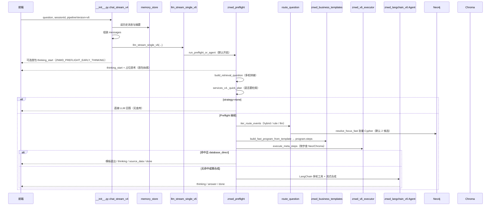

# 智能问答（ZNWD）后端流程说明

现网前端只调用 **`POST /api/znwd/chat/stream_v4`**（见 `fronted/app/GLCX/ZNWD/page.tsx`）。默认流水线为 **v6**（环境变量 `ZNWD_PIPELINE_VERSION`，未设时默认 `v6`）。

## 一、总览（从用户输入到 SSE 输出）

## 二、入口：`__init__.py` → `chat_stream_v4`

| 步骤 | 做什么 |
|------|--------|
| 1 | 解析 `question`、`sessionId`、`userId`、`llmModelKey`、`pipelineVersion` |
| 2 | Redis 加载会话历史 + 摘要，拼进 `messages` |
| 3 | `resolve_llm_model` 解析模型与 API |
| 4 | Token 预估，超限则 `token_limit` 事件 |
| 5 | 按 `pipelineVersion` 选择流式实现：`v6` / `v5` / `v4` |
| 6 | 把 `(event_type, data)` 转成 SSE 推给前端 |

## 三、v6 主路径（默认）

### 3.1 `services_v6.py` → `znwd_langchain_v6.llm_stream_single_v6`

- `ZNWD_V6_PREFLIGHT=1`（默认）：先走 **Preflight**，未 `done` 再进 **Agent**。
- `ZNWD_V6_PREFLIGHT=0`：直连 Agent。

### 3.2 Preflight：`znwd_preflight.py`

1. **检索问句** `build_retrieval_question`：短追问拼接、承前主体（`services_v5._build_v5_retrieval_question`）。
2. **V4 闸门** `_quick_plan`：若 `strategy=none` → 不查库，单次 `DIRECT_ANSWER`。
3. **业务路由** `iter_route_events` / `route_question`（`znwd_llm_router.py` + `znwd_hybrid_router.py`）  
   - `ZNWD_INTENT_MODE=hybrid`（**默认**）：规则 + `resolve_focus_fast`；置信度低于 `ZNWD_ROUTE_CONFIDENCE_THRESHOLD` 时 LLM 流式兜底。  
   - `ZNWD_INTENT_MODE=rule`：规则意图 + 图谱关键词。  
   - `ZNWD_INTENT_MODE=llm`：全量 LLM 路由（较慢，兼容旧配置）。  
   - 日志：`[V6][Preflight] ttft_ms`、`conf`、`route_ms`、`neo_ms`。
4. **快速 program** `try_build_fast_path_program` → `znwd_business_templates.build_fast_program_from_template`  
   产出固定 `steps`（`neo_list_nodes` / `neo_relation_query` / `chroma_*` 等）。
5. **思考区文案** `plan_thinking_display_text` → `znwd_thinking_narrative`（用户可读中文，无 BIZ_/箭头路径）。
6. **执行检索** `znwd_v6_executor.execute_meta_steps`。
7. **结果分支**  
   - Chroma 有命中 → 交 Agent 合成。  
   - Neo 无命中 → 可 V4 补充检索或直接回答。  
   - `database_direct` 且充足 → 模板直出，结束。

### 3.3 Agent：`znwd_langchain_v6.py` + `znwd_v6_tools.py`

- LangChain 绑定 `TOOL_*`，白名单调用 Neo/Chroma。
- 流式输出 `<THINK>` / `<CONTENT>`（或兼容标签），经清洗后 SSE 下发。

## 四、核心模块对照表

| 文件 | 作用（现网 v6） |
|------|------------------|
| `__init__.py` | HTTP 路由、SSE、`stream_v4` 入口 |
| `memory_store.py` | Redis 会话与摘要 |
| `znwd_preflight.py` | v6 前置快速路径 |
| `znwd_intent_mode.py` | `ZNWD_INTENT_MODE` rule/llm 开关 |
| `znwd_llm_router.py` | LLM/规则业务路由决策 |
| `znwd_keyword_resolver.py` | 关键词→节点类型、完整名称（如无人机A型） |
| `intent_classifier.py` | 规则意图（枚举/关系/标准章节等） |
| `znwd_business_templates.py` | 业务模板 → program.steps |
| `znwd_thinking_narrative.py` | 思考区用户语义封装 |
| `znwd_fast_route.py` | Preflight/V5 共享快速路径 API |
| `znwd_v6_executor.py` | 执行 META_OPS 步骤 |
| `retrieval_meta_ops.py` | 元操作定义、关系 schema |
| `znwd_v6_tools.py` | Agent 工具实现 |
| `znwd_langchain_v6.py` | v6 Agent 流式 |
| `services_v4.py` | `_quick_plan`、V4 补充检索、承前主体、部分 Neo 结构化查询 |
| `services_v5.py` | v5 全链路；v6 Preflight 复用其中步骤/归一化/直出 |
| `prompts_v4.py` / `v5` / `v6` | 各阶段 LLM 提示词 |
| `source_table.py` | 来源表格 SSYQ |

## 五、遗留（默认不注册路由）

| 文件/路由 | 说明 |
|-----------|------|
| `services.py` + `/chat/stream` | v1 双路检索 |
| `services_v2.py` + `/chat/stream_v2` | v2 带 thinking |
| `services_v3.py` + `/chat/stream_v3` | v3 查询生成 |
| `services_v4.llm_stream_single` | 仅当 `pipelineVersion` 非 v5/v6 时使用 |
| `znwd_template_config.py` | 依赖 `business_templates.json`，未部署 JSON 时逻辑已旁路 |

启用遗留 HTTP 接口：环境变量 **`ZNWD_LEGACY_STREAM=1`** 后重启（见 `__init__.py`）。

## 六、常用环境变量

| 变量 | 默认 | 含义 |
|------|------|------|
| `ZNWD_PIPELINE_VERSION` | v6 | v4 / v5 / v6 |
| `ZNWD_V6_PREFLIGHT` | 1 | v6 是否先走 Preflight |
| `ZNWD_INTENT_MODE` | rule | rule=规则路由；llm=LLM 选模板+槽位 |
| `ZNWD_LEGACY_STREAM` | 0 | 是否注册 v1/v2/v3 路由 |
