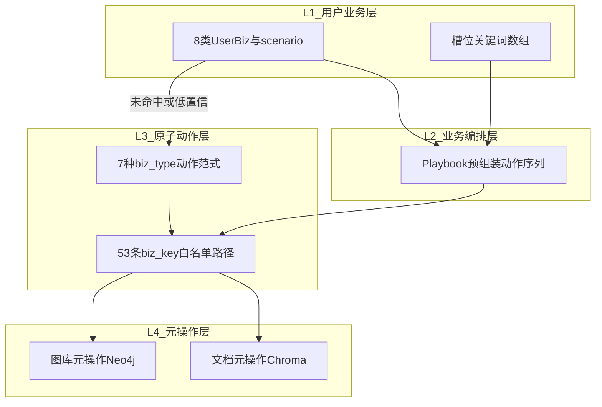
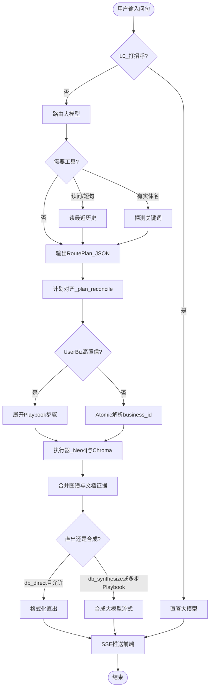
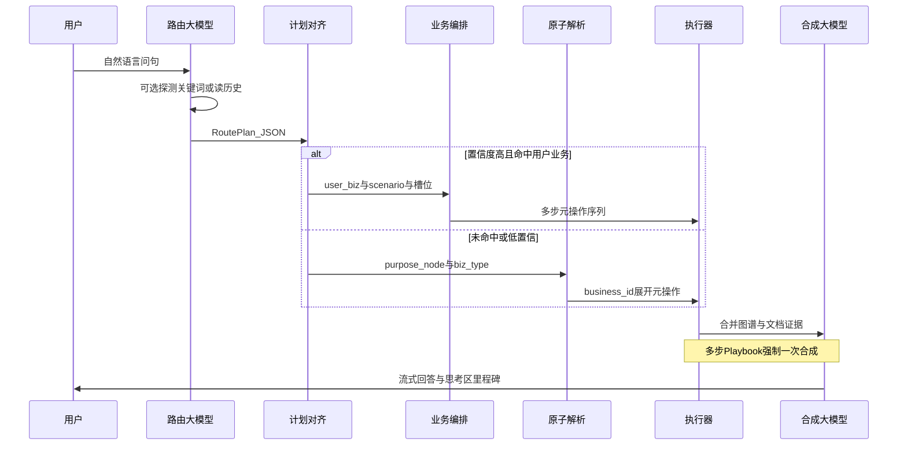

# ZNWD1 分层架构说明

本文档是 ZNWD1 智能问答的**架构单一权威说明**：理清「8 类用户业务 → Playbook 编排 → 7 种原子动作范式 → 2 类元操作引擎」四层关系、路由大模型提示词与输出格式、以及端到端流程。实现代码与本文对齐；细节以 `meta_ops.py` 为图谱数据源。

相关文档：[README.md](README.md)（模块索引）、[FLOW.md](FLOW.md)（验收问句与 HTTP）。

---

## 1. 设计目标：一层层向下

| 诉求 | 实现方式 |
|------|----------|
| 封装好的业务**又快又准** | 路由大模型命中 **L1 用户业务** → **L2 Playbook** 固定动作序列，只填关键词槽位 |
| **全覆盖**长尾问法 | 未命中或低置信 → **L3 原子动作**（7 种范式 + 53 条路径白名单 + guardrail） |
| 执行**合法、不编造** | **L4 元操作**白名单；大模型不生成 Cypher、不选 op_code |
| 拼装多意图 | L1 拼装业务（如「先要项目再要方法」）多步查库 + **一次合成答复** |

---

## 2. 四层模型总览

| 层级 | 中文名 | 谁使用 | 规模 | 代码落点 |
|------|--------|--------|------|----------|
| **L1** | 用户业务层 | 路由大模型 | 8 大类 + 每类若干 **scenario**（约 20 条进提示词）+ 3 个拼装业务 | `user_biz_catalog.py` |
| **L2** | 业务编排层（Playbook） | 仅程序 | 每个 `(user_biz, scenario)` 预封装 1～N 步原子模板 + 槽位映射 | `playbook_resolver.py` |
| **L3** | 原子动作层 | 路由大模型（fallback） | **7 种动作范式**（`biz_type`）→ 程序展开 **53 条 biz_key** 路径（不进提示词） | `business_catalog_v2.py`、`plan_reconcile.py` |
| **L4** | 元操作层 | 仅程序 | **2 类引擎**：图库 Neo4j（8 个 op_code）+ 文档 Chroma（4 个 op_code） | `meta_ops.py`、`business_expand.py`、`executor.py` |

### 2.1 层级关系图



### 2.2 层间职责（设计原则）

- **L1 → L2**：大模型只输出「业务 ID + 场景 ID + 槽位关键词」；**不选** Cypher、不选 `op_code`、不写 `BIZ_` 代号。
- **L2**：`user_biz_catalog` 绑定 `business_id` 与参数构造器；`playbook_resolver.expand_playbook` 展开为可执行步骤。
- **L3 fallback**：`match_confidence` 为 `low` 或 `user_biz` 为空时，填 `purpose_node`（7 类图节点之一）+ `biz_type`（7 种范式之一）；`resolve_business_from_plan` → `business_id` → `biz_key`（日志/校验）。
- **L4**：`business_expand` 将 `business_id` + 参数**确定性**映射为 `meta_ops` 步骤；路由大模型与合成大模型**均不直接调用** L4。

### 2.3 与「7 个动作」「2 个元操作」的对应

您口径中的概念与本文四层对应关系如下：

| 您的说法 | 本文层级 | 说明 |
|----------|----------|------|
| **8 类业务** | L1 | 用户视角顶层业务（试验项目、考核指标、试验方法…） |
| **7 个动作** | L3 | **7 种原子动作范式** = 6 种图相关 `biz_type` + `document`（文档检索与图节点分离） |
| **2 个元操作** | L4 | **2 类执行引擎**：图库（Neo4j）+ 文档库（Chroma）；其下共 13 个 `op_code` 子操作 |

L2 Playbook 是 L1 与 L3 之间的**编排胶水**：把「业务」包装成固定的 L3 动作序列，大模型无需再选范式。

---

## 3. L1：用户业务层（8 类 + 场景）

### 3.1 槽位（params_draft）

路由大模型向 `params_draft` 填入下列数组（可多值，程序侧支持 `fuzzy_any` OR 查询）：

| 字段 | 中文含义 |
|------|----------|
| `equipment_keywords[]` | 具体装备/设备名（如「坦克」） |
| `equipment_type_keywords[]` | 装备类型/类别（如「地面装备」） |
| `environment_keywords[]` | 试验环境（如「盐雾」「高温」） |
| `project_keywords[]` | 试验项目名称 |
| `indicator_keywords[]` | 考核/性能指标名 |
| `standard_keywords[]` | 标准号/标准文件名 |
| `focus` | 主关键词（可与上列合并） |

### 3.2 八类业务与场景

#### 1）试验项目（`UBIZ_TEST_PROJECT`）

| scenario | 典型问法 | 建议槽位 |
|----------|----------|----------|
| `by_equipment` | 坦克有哪些试验项目？ | `equipment_keywords` |
| `by_environment` | 盐雾环境下有哪些试验项目？ | `environment_keywords` |
| `by_equip_and_env` | 某装备在盐雾下要做哪些项目？ | `equipment_keywords` + `environment_keywords` |
| `enum` | 有哪些试验项目？ | 可无 |

#### 2）考核指标（`UBIZ_INDICATOR`）

| scenario | 典型问法 | 建议槽位 |
|----------|----------|----------|
| `by_equipment` | 坦克要考核哪些指标？ | `equipment_keywords` |
| `by_equip_type` | 地面装备类要考核哪些指标？ | `equipment_type_keywords` |
| `list_all` | 考核指标呢？/ 有哪些指标？ | 可无 |

#### 3）试验方法（`UBIZ_TEST_METHOD`）

| scenario | 典型问法 | 建议槽位 |
|----------|----------|----------|
| `by_project` | 飞行振动测试有哪些方法？ | `project_keywords` |
| `by_indicator` | 某指标对应哪些试验方法？ | `indicator_keywords` |
| `by_equipment_via_project` | 坦克经项目关联的方法 | `equipment_keywords` |
| `by_equipment_via_indicator` | 坦克经指标关联的方法 | `equipment_keywords` |
| `content` | 某方法的具体步骤/正文是什么？ | `project_keywords` 或方法名 |

#### 4）装备（`UBIZ_EQUIPMENT`）

| scenario | 典型问法 | 建议槽位 |
|----------|----------|----------|
| `under_type` | 地面装备下有哪些具体装备？ | `equipment_type_keywords` |
| `by_project` | 某项目涉及哪些装备？ | `project_keywords` |
| `by_indicator` | 某指标涉及哪些装备？ | `indicator_keywords` |

#### 5）装备类别（`UBIZ_EQUIPMENT_TYPE`）

| scenario | 典型问法 | 建议槽位 |
|----------|----------|----------|
| `level1_list` | 一级装备类别有哪些？ | 可无 |
| `level2_under_level1` | 陆地类下有哪些二级类别？ | `equipment_type_keywords` |
| `belongs_to` | 坦克属于哪类装备？ | `equipment_keywords` |

#### 6）环境（`UBIZ_ENVIRONMENT`）

| scenario | 典型问法 | 建议槽位 |
|----------|----------|----------|
| `list` | 有哪些试验环境？ | 可无 |
| `properties` | 环境如何分类/分级/组合？ | `environment_keywords`（可选） |
| `for_project` | 某项目在什么环境下试验？ | `project_keywords` |

#### 7）标准（`UBIZ_STANDARD`）

| scenario | 典型问法 | 建议槽位 |
|----------|----------|----------|
| `for_projects` | 某项目相关标准文件有哪些？ | `project_keywords` |
| `methods_in_standard` | GB/T xxx 包含哪些试验方法？ | `standard_keywords` |
| `chapter_content` | 标准第 5 章条文内容 | `standard_keywords` |

> **消歧**：「项目的方法」→ `UBIZ_TEST_METHOD`；「项目的标准/条文」→ `UBIZ_STANDARD` 或 `document`。

#### 8）其他试验知识（`UBIZ_KNOWLEDGE`）

| scenario | 典型问法 | 建议槽位 |
|----------|----------|----------|
| `keyword_doc` | 关键词检索标准/知识文档 | `standard_keywords` 或 `focus` |

### 3.3 拼装业务（多步、一次答复）

| user_biz | 中文 | 用户意图 |
|----------|------|----------|
| `COMP_PROJECT_THEN_METHOD` | 试验项目+方法（拼装） | 先要项目，再要这些方法 |
| `COMP_PROJECT_ENV_METHOD` | 装备环境+项目+方法（拼装） | 装备+环境下的项目及方法 |
| `COMP_INDICATOR_THEN_METHOD` | 考核指标+方法（拼装） | 先要指标，再要对应方法 |

---

## 4. L2：业务编排层（Playbook）

### 4.1 封装内容

**Playbook** = 一个或多个 **L3 业务模板**（`business_id`，如 `BIZ_REL_ONE_HOP`）+ 固定关系方向 + 槽位到参数的映射（`focus`、`value_list`、`from_values_ref`）。

程序在 `playbook_resolver` 中通过 **参数构造器**（如 `rel_eq_tp_fwd`）生成 params，再经 `business_expand` 落到 L4。

### 4.2 示例（中文）

| 用户业务 + 场景 | 编排动作（中文） |
|-----------------|------------------|
| `UBIZ_TEST_PROJECT` + `by_equipment` | 单跳：**装备** —关联→ **试验项目**（模糊匹配装备名） |
| `UBIZ_TEST_METHOD` + `by_project` | **按项目名称查关联试验方法** |
| `COMP_PROJECT_THEN_METHOD` | 步骤1：装备→项目，得到项目 Id；步骤2：用 **上一步项目 Id 列表** 批量查项目→方法；合并证据后 **一次合成** |

多步之间通过 `from_values_ref`（引用上一步返回节点的 `Id`）串联，大模型不参与步骤设计。

### 4.3 置信度与降级

| match_confidence | 行为 |
|------------------|------|
| `high` / `medium` | 走 Playbook（`plan_reconcile` 优先） |
| `low` 或 `user_biz` 为空 | 跳过 Playbook，走 L3 Atomic fallback |

`plan_reconcile` 另含 guardrail（如领域词禁止 `direct_llm`、标准 vs 方法冲突纠正）。

---

## 5. L3：原子动作层（7 种范式 + 53 条路径）

### 5.1 七种动作范式（biz_type）

路由 fallback 时，大模型选择 **目的节点** `purpose_node` + **动作范式** `biz_type`：

| biz_type | 中文动作范式 | 典型 purpose_node | 大模型需填参数 |
|----------|--------------|-------------------|----------------|
| `node_kw` | 按名称定位某一个节点 | 7 类图节点之一 | `focus`（关键词） |
| `node_prop` | 读取节点属性（含方法正文 SYNR） | 7 类之一 | `focus` / `focus_id`；可选 `property_fields` |
| `node_prop_rev` | 按属性值筛选有哪些节点 | 如 EquipmentType | `field`、`value` |
| `enum` | 列举该类全部节点（无具体名） | 7 类之一 | 可无 focus；「考核指标呢」→ Indicator |
| `hop_n` | 两类实体谁连着谁（正查/反查） | **答案侧**节点类型 | `known_type`、`focus`、`hop_direction`（forward/reverse） |
| `document` | 标准章节/条文向量检索 | 不绑图节点 | `query`（可用 retrieval_question） |

第 7 种在实现上与上表一致：**`document` 与图节点查询分离**，避免把「GB/T 第 X 章」误走图库 File 节点。

### 5.2 十一种业务模板（business_id）

程序将 `biz_type` + `purpose_node` 解析为下列 **业务模板**（大模型**不**直接选择代号，由 `resolve_business_from_plan` 完成）：

| business_id | 中文标题 |
|-------------|----------|
| `BIZ_REL_ONE_HOP` | 单跳关系查询（从起点查终点） |
| `BIZ_REL_REVERSE_ONE_HOP` | 单跳关系查询（从终点反查起点） |
| `BIZ_REL_TWO_HOP` | 两步关系查询 |
| `BIZ_EQUIP_PROJECT_BY_METHOD` | 按试验方法反查设备与项目 |
| `BIZ_PROJECT_TO_METHOD` | 按测试项目名称查方法 |
| `BIZ_METHOD_CONTENT` | 查试验方法正文（图库 SYNR 优先） |
| `BIZ_DOCUMENT` | 标准/文档章节检索 |
| `BIZ_ENUM_NODES` | 列举某类节点 |
| `BIZ_NODE_KW` | 按名称关键词定位节点 |
| `BIZ_NODE_PROP` | 读取节点属性 |
| `BIZ_NODE_PROP_REV` | 按属性值筛选节点 |

### 5.3 53 条 biz_key 白名单

`resolve_biz_key(purpose_node, biz_type, known_type, hop_direction, …)` 生成形如 `TestProject.from_Equipment.fwd`、`TestMethod.from_Equipment.hop2_via_TP` 的路径字符串。

- **不注入**路由提示词（控制 token 与误选率）
- 用于日志、guardrail 与后续扩展校验

---

## 6. L4：元操作层（2 类引擎）

### 6.1 图库引擎（Neo4j，8 个子操作）

| op_code | 中文释义 |
|---------|----------|
| `neo_node_query` | 单标签节点模糊查询（按名称等字段锁定实体） |
| `neo_list_nodes` | 按节点类型列举全库节点 |
| `neo_testproject_list_hierarchical` | 列举试验项目并带出父子层级（HAS） |
| `neo_equipment_indicators` | 按装备查考核指标（图边 + 属性兜底） |
| `neo_equip_project_by_method` | 按试验方法反查装备→项目→方法 |
| `neo_equipment_under_type` | 按装备类型查其下全部具体装备 |
| `neo_relation_query` | 单跳关系查询（支持模糊、Id 列表、引用上一步） |
| `neo_property_filter` | 对上一步结果按属性过滤 |

### 6.2 文档引擎（Chroma，4 个子操作）

| op_code | 中文释义 |
|---------|----------|
| `chroma_vector_search` | 向量召回文档片段 |
| `chroma_score_filter` | 按相似度/距离阈值过滤 |
| `chroma_rerank` | 重排序 |
| `chroma_section_expand` | 按章节前缀扩展（如 1.1 下所有小节） |

### 6.3 图谱本体（注入路由提示词）

**7 类图节点**（`NODE_LABELS`）：

| 英文标签 | 中文 |
|----------|------|
| EquipmentType | 装备类型/二级分类 |
| Equipment | 具体装备 |
| Environment | 试验环境 |
| TestProject | 试验项目 |
| Indicator | 考核指标 |
| TestMethod | 试验方法 |
| File | 标准文件 |

**3 种关系**：

| 关系 | 中文 | 典型方向 |
|------|------|----------|
| HAS | 归属/父子 | EquipmentType→Equipment；TestProject→TestProject |
| CON | 关联 | Equipment↔TestProject↔TestMethod↔Indicator 等 |
| BELONGS_TO | 标准归属 | TestMethod→File |

属性中文名由 `prompts/graph_schema.py` 从 `meta_ops.NODE_ENTITY_FIELDS` 生成（如 `SYNR`=试验内容，`Source_name`=来源文件名）。

---

## 7. 路由大模型提示词结构

实现文件：`prompts/routing_prompt_builder.py` → `build_routing_system_prompt()`。

按出现顺序：

1. **角色与总原则**：清单库（Neo4j/Chroma）优先；禁止域外 `direct_llm`（如把「考核指标」答成 KPI）
2. **路由顺序**：先 L1 UserBiz + scenario → 再 L3 Atomic fallback
3. **工具**（非业务动作）：`znwd1_probe_keyword`（关键词探测）、`znwd1_history_recent_qa`（续问/上一问）、`znwd1_history_similar_questions`
4. **L1 业务表**：`user_biz_prompt_markdown()` — 8 类 + scenario + 槽位说明
5. **图谱本体（超简）**：`graph_schema_ultra_compact_markdown()`
6. **属性索引**：`routing_property_index_markdown()`
7. **消歧铁律**：`routing_disambiguation.DISAMBIGUATION_RULES_MARKDOWN`
8. **L3 Atomic fallback 简表**：7 种 `biz_type` 说明
9. **RoutePlan 字段说明 + JSON 示例**
10. **输出要求**：最后一轮仅输出纯 JSON，无 markdown 围栏

### 7.1 明确不写入提示词的内容

- 53 条 `biz_key` 全表
- 11 个 `BIZ_*` 业务代号
- 全部 `op_code` 与 Cypher
- Playbook 内部步骤定义与 `from_values_ref` 细节

---

## 8. 路由大模型输出格式（RoutePlan）

解析器：`route_plan_schema.parse_route_plan_json`。

### 8.1 主路径（命中 L1）

```json
{
  "user_biz": "UBIZ_TEST_PROJECT",
  "scenario": "by_equipment",
  "match_confidence": "high",
  "answer_strategy": "db_synthesize",
  "use_history": false,
  "retrieval_question": "坦克有哪些试验项目",
  "keyword": "坦克",
  "params_draft": {
    "equipment_keywords": ["坦克"],
    "environment_keywords": [],
    "project_keywords": [],
    "indicator_keywords": [],
    "standard_keywords": [],
    "focus": "坦克"
  },
  "probe_snapshot": {
    "best": {
      "node_type": "Equipment",
      "id": "节点Id来自探测",
      "name": "坦克"
    }
  }
}
```

### 8.2 Fallback 路径（落入 L3）

```json
{
  "user_biz": "",
  "scenario": "",
  "match_confidence": "low",
  "answer_strategy": "db_synthesize",
  "purpose_node": "TestMethod",
  "biz_type": "hop_n",
  "known_type": "TestProject",
  "hop_direction": "forward",
  "params_draft": {
    "focus": "飞行振动测试"
  },
  "retrieval_question": "飞行振动测试的试验方法是什么",
  "keyword": "飞行振动测试"
}
```

### 8.3 字段中文释义

| 字段 | 中文含义 |
|------|----------|
| `user_biz` | 顶层业务 ID（8 类或拼装 COMP_*） |
| `scenario` | 场景 ID（如 by_equipment、enum） |
| `match_confidence` | 命中置信度：high / medium / low |
| `answer_strategy` | direct_llm \| db_direct \| db_synthesize |
| `use_history` | 是否依赖对话历史 |
| `retrieval_question` | 补全后的单句检索问法 |
| `keyword` | 图谱检索核心词 |
| `params_draft` | 槽位与 focus 等草稿参数 |
| `probe_snapshot` | 关键词探测结果（禁止编造 id） |
| `purpose_node` | fallback：答案实体类型（英文标签） |
| `biz_type` | fallback：7 种动作范式之一 |
| `known_type` | fallback：关系类已知一端节点类型 |
| `hop_direction` | fallback：forward（正查）/ reverse（反查） |
| `biz_key` | 可留空，由程序解析 |
| `history_snapshot` | 历史问答快照（程序写入，供直答） |

---

## 9. 整体智能问答流程

### 9.1 主流程（flowchart）



### 9.2 时序（按角色）



### 9.3 程序流水线（与代码对应）

```
用户问句
  → [L0] 打招呼 → direct_llm
  → 路由大模型（UserBiz 表 + 本体 + 消歧 + 工具）
  → RoutePlan JSON
  → plan_reconcile（Playbook 优先 → Atomic v2 + guardrail）
  → expand_playbook_meta_steps | expand_business
  → execute_meta_steps（Neo4j + Chroma）
  → formatters 直出 | stream_synthesis 合成
  → SSE（thinking / answer / done；含 userBizTitle）
```

入口：`pipeline.stream_znwd1_chat`；HTTP：`POST /api/znwd1/chat/stream`。

---

## 10. 已知缺口与演进

| 项 | 说明 |
|----|------|
| `UBIZ_TEST_PROJECT` + `by_equip_and_env` | 已实现：装备→项目后按 `TestProject.EnvironmentId` 过滤（需解析环境节点 Id，来自 probe_snapshot.hits 或二次探测） |
| 路由误选 scenario | 依赖消歧铁律 + `playbook_guardrail_question`；低置信自动降级 L3 |

---

## 11. 模块索引

| 模块 | 职责 |
|------|------|
| `user_biz_catalog.py` | L1 业务与 scenario 注册表 |
| `playbook_resolver.py` | L2 展开 Playbook |
| `business_catalog_v2.py` | L3 purpose+biz_type → business_id |
| `business_expand.py` | L3 business_id → L4 steps |
| `meta_ops.py` | L4 元操作定义（单一数据源） |
| `plan_reconcile.py` | RoutePlan → 可执行 rec |
| `pipeline.py` | SSE 主流水线 |
| `prompts/routing_prompt_builder.py` | 路由提示词拼装 |
| `znwd1_domain_guard.py` | 清单库优先、模糊指标兜底 |
