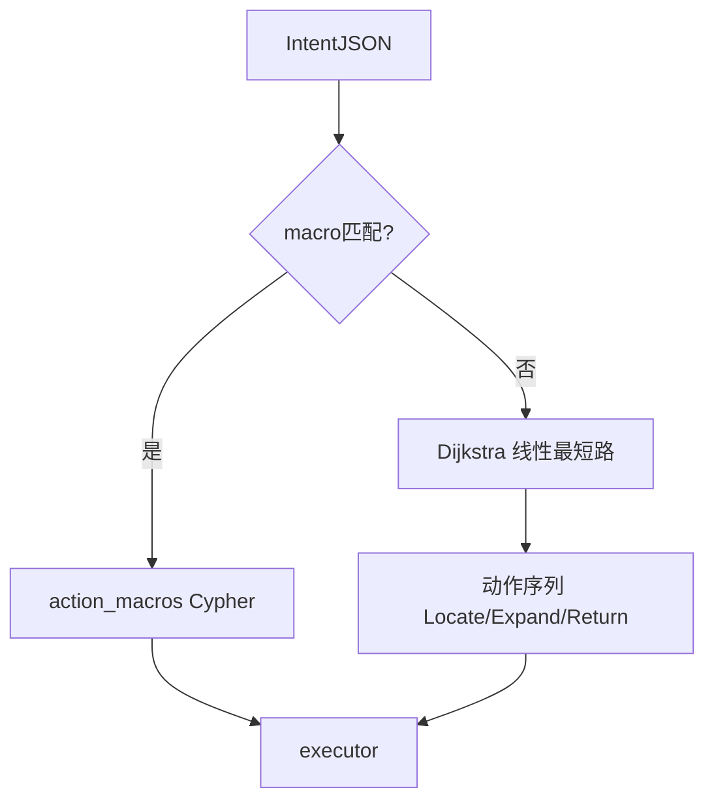

# ZNWD2 架构说明

## 设计目标

将问答流程拆为可解释的三段式管道：

1. **意图解析** — LLM 输出固定 schema 的 JSON，不做 Cypher 生成。
2. **路径规划** — 本体模式图 + 业务代价；高频模式走宏，长尾走 Dijkstra 线性路径。
3. **查询执行** — 动作原语或宏 Cypher，结果直出格式化。

## 四层对照（与 ZNWD1）

| ZNWD2 | 职责 |
|-------|------|
| Intent JSON | 等价于 ZNWD1 路由 LLM 的结构化输出 |
| action_macros | 等价于 ZNWD1 Playbook 固定路径 |
| path_planner + ontology | 等价于 ZNWD1 Atomic 路径白名单 + guardrail |
| executor 动作原语 | 等价于 ZNWD1 meta_ops（更细粒度） |

## Intent JSON

```json
{
  "intent_type": "查指标|查项目|查方法|查文件",
  "start_entities": ["Equipment"],
  "start_filters": {"Name": "无人机"},
  "environment_constraint": null,
  "target_entities": ["Indicator"],
  "additional_filters": null
}
```

## 路径规划策略



**分支/V 形路径**（设备+环境共同约束项目）通过宏 `查项目_有环境` / `查方法_经项目_有环境` 实现。**指标仅依赖设备**，宏 `查指标` 为 Equipment→Indicator 一步，不经 TestProject。

消歧规则详见 [disambiguation.py](disambiguation.py)（对齐 ZNWD1）。

## 代价模型

- 基础边代价 = 1
- **查指标**：Equipment→Indicator ×0.5；Equipment→TestProject ×5（避免误走项目）
- **查项目**：Equipment/Environment→TestProject ×0.5
- **查方法/查文件**：指向目标类型的边 ×0.5

## 动作原语

| 动作 | 说明 |
|------|------|
| LocateNode | 按标签+属性定位节点集 |
| Expand | 沿关系扩展邻居 |
| Intersect | 两集合求交 |
| Union | 两集合并 |
| FilterProperty | 属性过滤 |
| ReturnAttributes | 投影返回字段 |

## 图谱 Schema

数据源：[schema.py](schema.py)，与 ZNWD1 `meta_ops.py` 对齐。

## SSE 事件

与 ZNWD1 兼容：`thinking_start` / `thinking` / `answer` / `done` / `error`。

thinking.kind：`system` | `route` | `retrieval`
